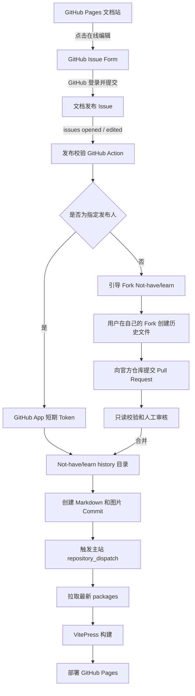

# 在线 Markdown 编辑与历史文档发布技术方案

> 状态：设计阶段  
> 适用项目：`micro-scaff.github.io` 与 `Not-have/learn`（本地路径 `packages/learn`）  
> 部署约束：继续使用 GitHub Pages，不购买或维护独立服务器  
> 最后更新：2026-11-19

## 1. 文档目的

本文档定义一个完全依托 GitHub 免费能力的在线 Markdown 编辑与发布流程。当前仅处理 `Not-have/learn` 仓库：用户在线填写 Markdown 和上传图片，提交后由 GitHub Actions 生成不可变的历史文档，将 Markdown 与图片提交到 `learn` 仓库，并重新构建当前 VitePress 文档站。

本文档作为后续开发、权限配置、测试和验收的依据。

## 2. 背景与现状

当前项目具有以下特点：

- 使用 VitePress 生成静态文档站。
- 通过 GitHub Pages 发布到 `https://micro-scaff.github.io/`。
- 文档站虽然包含多个 `packages/*` 仓库，但本功能第一阶段只处理 `packages/learn`。
- `packages/learn` 对应远程仓库 `https://github.com/Not-have/learn`，默认分支为 `main`。
- `learn` 现有 Markdown 主要使用 `./images/<文件名>` 引用同仓库图片。
- `.vitepress/projects.ts` 维护项目、文档目录和仓库地址的映射。
- `scripts/update-packages.sh` 在构建时拉取各文档仓库的最新默认分支。
- `.github/workflows/docs.yml` 在主站 `main` 分支更新后构建并发布 GitHub Pages。

现有流程只适合“仓库中已经存在 Markdown”的场景，不提供浏览器端的内容提交入口，也不会在子仓库更新时自动触发主站发布。

## 3. 目标

### 3.1 功能目标

1. 用户可以在线填写并预览 Markdown。
2. 用户必须登录 GitHub 后才能提交。
3. 明确允许的 GitHub 用户可以直接发布文档。
4. 非指定人员不能直接写 `Not-have/learn`，只能 Fork 该仓库后通过 Pull Request 投稿。
5. 第一阶段目标仓库固定为 `Not-have/learn`，页面不提供任意仓库选择。
6. 每次提交生成一个新的历史文档，不覆盖既有历史文件。
7. 指定人员的发布动作自动提交到 `Not-have/learn`。
8. 外部投稿只有在维护者审核并合并 Pull Request 后才进入官方仓库。
9. 编辑过程中可以上传图片，图片文件直接保存到 `Not-have/learn`。
10. Markdown 使用相对路径引用仓库中的图片，不依赖外部图床。
11. Markdown 和本次上传的全部图片必须在同一个 Commit 中发布。
12. 图片上传能力只对 `packages/learn` 开启，站点中其他文档来源不显示也不接受图片上传。
13. 官方仓库更新后自动触发主站重新构建和部署。
14. 整个方案不需要购买服务器。

指定人员通过本站发布时默认直接写入 `learn/main`，不创建 Pull Request。只有自动发布检测到无法安全快进、路径占用或其他需要人工决定的冲突时，才创建冲突分支和 Pull Request。

### 3.2 安全目标

1. GitHub 写入凭证不得出现在 GitHub Pages、浏览器存储、Issue 内容或构建日志中。
2. 浏览器不得持有长期 Personal Access Token。
3. 提交者不能通过篡改表单向白名单外的仓库或路径写文件。
4. 工作流使用最小权限。
5. 同一个提交事件只能生成一次历史文档。
6. 所有发布动作都可以追踪到 GitHub 用户、Issue、Commit 和工作流运行记录。
7. Fork 中的代码和工作流不能接触官方仓库的 Actions Secrets。
8. 上传文件必须经过来源、格式、大小、文件头和路径校验。

### 3.3 非目标

第一阶段不包含以下功能：

- 多人实时协作编辑。
- 私有草稿云端保存。
- 自定义用户名和密码系统。
- 精确控制为 30 天的自定义登录会话。
- 在浏览器中直接保存 GitHub Token。
- 修改或删除已经发布的历史文档。

## 4. 关键约束与设计结论

### 4.1 GitHub Pages 是静态托管

GitHub Pages 只能发布静态 HTML、CSS 和 JavaScript，不能运行密码验证、OAuth Token 交换或安全的仓库写入接口。

参考：

- [What is GitHub Pages](https://docs.github.com/en/pages/getting-started-with-github-pages/what-is-github-pages)
- [Creating a GitHub Pages site](https://docs.github.com/en/pages/getting-started-with-github-pages/creating-a-github-pages-site)

因此，不能把共享密码、GitHub App 私钥或 Personal Access Token 编译进 VitePress 产物。

### 4.2 不在纯静态页面中实现 GitHub OAuth Token 交换

GitHub 的 Web OAuth 流程需要交换临时授权码；Token 端点不支持浏览器跨域预检请求。即使 GitHub App 支持 PKCE，也不能把完整 Token 交换流程安全地放进当前 GitHub Pages 单页应用。

参考：

- [Authorizing OAuth apps](https://docs.github.com/en/apps/oauth-apps/building-oauth-apps/authorizing-oauth-apps)
- [Generating a user access token for a GitHub App](https://docs.github.com/en/apps/creating-github-apps/authenticating-with-a-github-app/generating-a-user-access-token-for-a-github-app)

因此，本方案不在 GitHub Pages 中自行保存登录凭证，而是让 GitHub 的 Issue 页面负责登录和提交身份。

### 4.3 “30 天有效”的处理

纯 GitHub 方案下，登录会话由 GitHub 管理，本站无法指定 GitHub 登录态必须精确持续 30 天。

本方案将原“密码 30 天有效”调整为：

- 用户未登录 GitHub 时，由 GitHub 要求登录。
- 用户已经登录 GitHub 时，沿用 GitHub 自身会话。
- 用户可以随时从 GitHub 退出登录或撤销授权。
- 本站不额外保存密码或 Token。

如果未来必须实现“共享密码登录后固定 30 天失效”，则必须增加服务端函数或其他可信后端，不属于本方案范围。

## 5. 总体架构



### 5.1 使用的 GitHub 能力

| 能力 | 用途 |
| --- | --- |
| GitHub Pages | 托管公开文档站 |
| GitHub Issue Form | 提供登录保护的文档提交表单 |
| GitHub Issue Attachments | 接收指定人员拖拽或粘贴的临时图片 |
| GitHub Actions | 校验、生成文件、提交和部署 |
| GitHub App | 以最小权限写入指定仓库 |
| GitHub Fork / Pull Request | 接收非指定人员的投稿并执行人工审核 |
| Repository Dispatch | 子仓库更新后触发主站部署 |
| Git Commit / Issue / Pull Request | 保存历史记录和审计信息 |

公开仓库使用标准 GitHub-hosted Runner 时，GitHub Actions 可以免费运行。实际使用仍应遵守 GitHub 的配额和服务条款。

参考：[GitHub Actions billing and usage](https://docs.github.com/en/actions/concepts/billing-and-usage)

## 6. 用户流程

### 6.1 指定人员：直接发布流程

1. 用户在文档站导航栏点击“在线编辑”。
2. 浏览器打开主站仓库的“发布历史文档”Issue Form。
3. GitHub 检查用户登录状态；未登录时先完成 GitHub 登录。
4. 用户填写标题、标签和 Markdown 正文；目标固定显示为 `Not-have/learn`。
5. 用户将图片拖拽或粘贴到 Markdown 字段，GitHub 生成附件链接。
6. 用户使用 GitHub 自带的 Preview 检查 Markdown 和图片。
7. 用户提交 Issue。
8. GitHub Actions 校验提交者、Markdown 和图片附件，并固定使用 `Not-have/learn`。
9. Action 下载通过校验的 GitHub 图片附件，生成仓库内图片路径并改写 Markdown。
10. Action 在目标仓库的同一个 Commit 中创建历史文档和全部图片。
11. Action 触发主站重新部署。
12. Action 在 Issue 中回复文件、图片目录、Commit、页面和工作流地址，并关闭 Issue。

### 6.2 非指定人员：Fork 和 Pull Request 流程

1. 非指定人员同样可以进入在线编辑入口并填写 Markdown。
2. 用户提交 Issue 后，Action 识别其不在直接发布名单中。
3. Action 不获取写入官方仓库的 GitHub App Token，也不创建官方 Commit。
4. Action 回复 `Not-have/learn`、建议文件路径、完整文档内容和 Fork 操作说明。
5. 用户打开 `https://github.com/Not-have/learn/fork`，把仓库 Fork 到自己的 GitHub 账户。
6. 用户在自己的 Fork 中创建分支、历史 Markdown 文件和对应图片目录。
7. 用户把 Markdown 中的图片地址改成相对于文档的仓库路径。
8. 用户向官方目标仓库提交同时包含 Markdown 和图片的 Pull Request。
9. 目标仓库的只读工作流校验文件路径、图片格式、相对引用和安全规则。
10. 指定维护者进行人工审核。
11. 审核通过并合并后，目标仓库通知主站重新构建。

GitHub 网页编辑器在用户编辑无写权限的仓库时，也可以引导用户创建 Fork 并提交 Pull Request。第一版仍明确展示 Fork 步骤，避免用户误认为投稿会自动进入官方仓库。

参考：

- [Editing files in another user's repository](https://docs.github.com/en/repositories/working-with-files/managing-files/editing-files#editing-files-in-another-users-repository)
- [Creating a pull request from a fork](https://docs.github.com/en/pull-requests/how-tos/create-pull-requests/creating-a-pull-request-from-a-fork)

### 6.3 第二阶段：站内增强编辑器

第二阶段可以在 VitePress 中增加独立的 Markdown 编辑页，用于改善写作体验：

- 左右分栏编辑和预览。
- 浏览器本地草稿。
- 标题、标签、项目选择。
- 字数统计。
- 离开页面前未保存提醒。
- 一键复制最终 Markdown。
- 一键打开 GitHub Issue Form。
- 为外部投稿者提供“Fork 并提交 PR”入口。
- 图片拖拽、粘贴、缩略图预览和删除。
- 自动插入 Markdown 相对引用占位符。

由于 GitHub Issue URL 不适合承载大篇幅正文，站内编辑器的提交动作采用：

1. 把正文写入系统剪贴板。
2. 打开 GitHub Issue Form。
3. 引导用户将正文粘贴到 Markdown 字段。
4. 用户在 GitHub 页面确认并提交。

这种设计多一步粘贴操作，但不需要在浏览器中保存 GitHub Token，也不会引入服务端。

## 7. Issue Form 设计

建议新增：

```text
.github/ISSUE_TEMPLATE/publish-history-document.yml
```

表单字段：

| 字段 | 类型 | 必填 | 说明 |
| --- | --- | --- | --- |
| 文档标题 | input | 是 | 用于 frontmatter 和一级标题 |
| 文档标识 | input | 否 | 用于生成 slug；为空时自动生成 |
| 标签 | input | 否 | 逗号分隔 |
| Markdown 正文 | textarea | 是 | 完整文档内容 |
| 图片附件 | textarea 内拖拽/粘贴 | 否 | 由 GitHub 先生成附件 URL，发布时复制进目标仓库 |
| 提交确认 | checkboxes | 是 | 确认内容可公开、同意生成历史文件 |

Issue 自动添加标签：

```text
document-submission
```

工作流处理状态标签：

```text
document-submission
document-validating
document-published
document-fork-required
document-rejected
document-failed
```

## 8. 固定目标仓库配置

第一阶段不使用可选仓库白名单，发布目标固定为 `Not-have/learn`。Action 内维护不可被 Issue 覆盖的配置：

建议新增：

```text
.github/document-publishing/target.json
```

```json
{
  "owner": "Not-have",
  "repository": "learn",
  "branch": "main",
  "documentDirectory": "history",
  "assetDirectory": "history/images",
  "imageUpload": true
}
```

Action 禁止接受 Issue 中填写的仓库 URL、分支、文档目录或图片目录。以后需要接入其他仓库时，再把这个单目标配置升级为仓库白名单。

### 8.1 图片能力开关

图片上传采用显式开启策略：

```text
packages/learn       → imageUpload: true
其他文档来源          → imageUpload: false（默认）
```

当 `imageUpload` 不是严格的 `true` 时：

- 编辑页面不展示拖拽区、上传按钮、粘贴图片提示和图片列表。
- Issue Form 不展示图片上传说明。
- Action 不执行附件下载、图片改写或图片提交步骤。
- Markdown 中出现 GitHub 附件 URL 时直接拒绝，而不是复制图片。
- Pull Request 校验不允许新增图片文件。

不能根据浏览器传入的项目名称开启图片上传；是否支持图片必须由仓库内受保护的配置决定。当前第一阶段只有 `Not-have/learn` 配置为 `true`。

## 9. 发布者权限模型

### 9.1 指定发布人员

提交者满足下面任意条件才允许发布：

1. `author_association` 是 `OWNER`、`MEMBER` 或 `COLLABORATOR`。
2. GitHub 用户名存在于显式允许名单中。

建议新增：

```text
.github/document-publishing/allowed-users.json
```

示例：

```json
[
  "Not-have"
]
```

指定人员校验通过后，Action 可以使用 GitHub App Token 将历史文件和图片直接提交到 `Not-have/learn`。

### 9.2 非指定人员

不满足直接发布规则的用户仍然允许投稿，但必须遵循以下限制：

- 不向其工作流提供 GitHub App Token。
- 不允许其直接写官方仓库。
- 不自动替用户创建 Fork，因为纯静态站点没有用户授权 Token。
- 给出目标仓库 Fork 地址和建议文件路径。
- 用户在自己的账户下完成 Fork。
- 用户以 Pull Request 形式请求合并。
- Pull Request 必须由指定维护者审核后才能合并。

Fork 地址格式：

```text
https://github.com/Not-have/learn/fork
```

### 9.3 Pull Request 审核规则

外部投稿的 Pull Request 必须满足：

1. 只新增一个位于 `history/` 下的 `.md` 文件及其在 `history/images/<document-stem>/` 下引用的图片。
2. 不允许修改 `.github`、构建脚本、依赖文件或其他已有文档。
3. 文件名和 frontmatter 满足本方案约定。
4. Markdown 不包含禁止的 HTML、脚本或危险链接。
5. Pull Request 至少获得一名指定维护者批准。
6. 官方仓库启用分支保护，外部用户不能直接向 `main` 推送。

### 9.4 为什么不能只依赖 Issue 标签

公开仓库的 Issue 页面可能允许任何 GitHub 用户提交内容。攻击者也可以伪造字段标题和正文，因此工作流必须重新解析并校验：

- 事件来源。
- 提交者身份。
- Issue 状态。
- 表单字段完整性。
- 固定目标配置。
- 文档大小和格式。

权限判断结果必须明确分流：

```text
指定人员     → 自动发布到官方仓库
非指定人员   → Fork + Pull Request + 人工审核
恶意或无效输入 → 拒绝
```

## 10. 历史文档格式

### 10.1 文件路径

推荐路径：

```text
history/YYYY-MM-DD-HHmmss-<slug>-<issue-number>.md
```

示例：

```text
history/2026-11-19-143025-api-design-128.md
```

当前站点的 `createDirectoryMenu` 只扫描 `learn` 根目录和下一层目录。历史文档直接放在 `history/` 下，可以自动形成一个历史文档分组；如果再按年/月嵌套，现有菜单不会发现更深层的 Markdown。

路径生成规则：

1. 时间统一使用 `Asia/Shanghai`。
2. `slug` 只允许小写字母、数字和连字符。
3. 中文标题没有可用 slug 时，使用 `document`。
4. Issue 编号用于防止冲突并提供反向追踪。
5. 最终路径必须位于固定配置的 `history/` 内。
6. 已存在同名文件时终止，不覆盖原文件。

### 10.2 Frontmatter

```yaml
---
title: "API 设计方案"
author: "Not-have"
createdAt: "2026-11-19T14:30:25+08:00"
documentId: "micro-scaff.github.io#128"
sourceIssue: "https://github.com/micro-scaff/micro-scaff.github.io/issues/128"
targetRepository: "Not-have/learn"
tags:
  - API
  - 设计
sidebar: true
---
```

正文处理规则：

- 正文保留用户原始 Markdown。
- 如果正文已经包含 frontmatter，第一阶段拒绝提交，避免重复 frontmatter 和字段注入。
- 如果正文没有一级标题，自动添加 `# <title>`。
- 如果正文已有一级标题，不强制替换。
- 文档末尾可以追加来源 Issue 链接，但不能写入任何 Secret。

### 10.3 图片目录和相对路径

`packages/learn` 现有文档普遍使用以下相对写法：

```md

```

历史文档延续这个习惯，但为每篇文档建立独立图片目录，避免重名：

```text
history/
├── 2026-11-19-143025-api-design-128.md
└── images/
    └── 2026-11-19-143025-api-design-128/
        ├── 01-a18f39c2d40e.png
        └── 02-6cbb87280d13.webp
```

Markdown 中写：

```md

```

规则：

1. 图片必须位于 `history/images/<document-stem>/`。
2. `<document-stem>` 必须与 Markdown 文件名去掉 `.md` 后完全一致。
3. Markdown 只能使用相对于当前文档的 `./images/...` 路径。
4. 不使用 `/images/...` 绝对站点路径，避免 GitHub 预览和 VitePress 路由不一致。
5. 不把新上传图片放到 `learn` 根目录的公共 `images/`，避免历史文档资源与旧文档资源混在一起。
6. 同一内容的重复图片按照 SHA-256 去重。

### 10.4 指定人员的图片上传流程

GitHub Issue 的 Markdown 输入框原生支持拖拽、选择和粘贴图片。图片首先成为 GitHub Issue 附件，表单中出现匿名附件 URL。GitHub 对 Issue 图片附件的上限是 10 MB，本项目采用更严格的限制。

参考：[Attaching files](https://docs.github.com/en/get-started/writing-on-github/working-with-advanced-formatting/attaching-files)

Action 按以下流程处理：

1. 从 Markdown AST 中提取图片节点，不使用正则表达式替代完整解析。
2. 只下载 GitHub 官方附件地址，例如 `github.com/user-attachments/assets/...` 和兼容的历史附件域名。
3. 每次重定向后重新校验 HTTPS、主机名和路径，防止 SSRF。
4. 下载时设置超时和字节上限，不信任响应中的 `Content-Length`。
5. 根据文件魔数识别真实格式，不信任 URL 后缀和 `Content-Type`。
6. 校验尺寸、总像素和解码结果，防止伪装文件及图片解压炸弹。
7. 计算 SHA-256，并生成 `<序号>-<哈希前12位>.<规范后缀>`。
8. 把图片写入 `history/images/<document-stem>/`。
9. 将 Markdown 中的远程附件 URL 改写为 `./images/<document-stem>/<filename>`。
10. 检查改写后不存在未处理的上传附件 URL。
11. 将 Markdown 和全部图片作为一个 Git Commit 写入 `Not-have/learn`。

Issue 附件在公开仓库中本身也是公开的，复制进 `learn` 后原附件 URL 可能仍然存在。因此用户不得上传隐私图片、凭证、密钥或其他敏感资料。

### 10.5 图片限制

| 项目 | 第一阶段限制 |
| --- | --- |
| 支持格式 | PNG、JPEG、GIF、WebP |
| SVG | 禁止，避免脚本和外部资源风险 |
| 单张大小 | 最大 5 MB |
| 单篇数量 | 最大 20 张 |
| 单篇图片总大小 | 最大 30 MB |
| 最大像素 | 2500 万像素 |
| 文件名 | Action 根据序号和 SHA-256 生成 |
| 远程图片 | 新发布文档禁止保留远程图片 URL |

### 10.6 外部投稿者的图片流程

非指定人员不通过官方 Action 下载附件，而是在自己的 Fork 中直接添加文件：

1. 在 Fork 中创建 `history/<document-stem>.md`。
2. 在 Fork 中创建 `history/images/<document-stem>/`。
3. 将图片上传到该目录。
4. Markdown 使用 `./images/<document-stem>/<filename>`。
5. 一个 Pull Request 同时包含 Markdown 和全部图片。

GitHub 网页端支持直接上传仓库文件；单文件浏览器上传限制高于本项目设定的 5 MB，因此第一阶段限制可以满足网页投稿。

参考：[Adding a file to a repository](https://docs.github.com/en/repositories/working-with-files/managing-files/adding-a-file-to-a-repository)

### 10.7 VitePress 复制适配

当前 `scripts/copy-markdown-files.js` 对 `learn` 只复制所有 Markdown 和根目录 `images/`。实现时必须把历史图片加入复制规则：

```js
{
  outDir: "src/learn",
  entry: "packages/learn",
  copyFiles: true,
  file: [/\.md$/, /^images\//, /^history\/images\//]
}
```

构建后的对应关系：

```text
packages/learn/history/...        → src/learn/history/...
packages/learn/history/images/... → src/learn/history/images/...
```

这样 VitePress、GitHub 仓库预览和最终站点使用同一条相对路径。

## 11. GitHub App 设计

### 11.1 使用 GitHub App 的原因

主站工作流内置的 `GITHUB_TOKEN` 默认只对当前仓库生效，不能安全地直接写入 `Not-have/learn`。使用专用 GitHub App 可以：

- 只安装到 `micro-scaff/micro-scaff.github.io` 和 `Not-have/learn`。
- 只授予必要权限。
- 在 Action 运行期间生成短期安装令牌。
- 从 GitHub 后台随时撤销访问。
- 让 Commit 清楚显示由哪个 App 创建。

### 11.2 最小权限

GitHub App 仓库权限：

| 权限 | 级别 | 用途 |
| --- | --- | --- |
| Metadata | Read | GitHub App 必需基础权限 |
| Contents | Read and write | 创建历史 Markdown 和图片、更新 `learn/main`、触发 Repository Dispatch |
| Pull requests | Read and write | 仅在指定人员的自动发布发生冲突时创建冲突 PR |

不授予以下权限：

- Administration。
- Actions 写权限。
- Workflows 写权限。
- Issues 写权限；Issue 回复使用主站工作流自己的 `GITHUB_TOKEN`。

### 11.3 Actions Secrets

主站仓库和 `Not-have/learn` 都需要配置：

```text
Actions Variable: DOC_PUBLISHER_APP_ID
Actions Secret:   DOC_PUBLISHER_PRIVATE_KEY
```

注意事项：

- 私钥只能配置在 GitHub Actions Secret 中。
- 私钥不得写入仓库文件、Issue、Artifact 或日志。
- 工作流不得输出 Token。
- 安装范围必须选择“Only select repositories”。

参考：

- [Choosing permissions for a GitHub App](https://docs.github.com/en/apps/creating-github-apps/registering-a-github-app/choosing-permissions-for-a-github-app)
- [Authenticating as a GitHub App installation](https://docs.github.com/en/apps/creating-github-apps/authenticating-with-a-github-app/authenticating-as-a-github-app-installation)

## 12. GitHub Actions 设计

### 12.1 文档发布工作流

建议新增：

```text
.github/workflows/publish-history-document.yml
```

触发条件：

```yaml
on:
  issues:
    types:
      - opened
      - edited
      - reopened
```

顶层最小权限：

```yaml
permissions:
  contents: read
  issues: write
```

处理步骤：

1. 检查 Issue 是否包含 `document-submission` 标签。
2. 如果已包含 `document-published`，直接结束。
3. 校验提交者权限。
4. 解析 Issue Form 字段。
5. 读取固定目标配置，目标必须是 `Not-have/learn@main`。
6. 校验标题、标签和正文。
7. 解析并下载 GitHub 图片附件。
8. 校验图片格式、大小、像素、哈希和安全性。
9. 生成历史文档、图片路径及相对引用。
10. 获取仅限 `Not-have/learn` 的 GitHub App 安装令牌。
11. 检查 Markdown 路径和图片路径均不存在。
12. 使用 Git Database API 为 Markdown 和图片创建 blobs。
13. 基于当前 `main` 创建包含全部新文件的 tree 和 commit。
14. 以非强制方式更新 `main` 引用，保证 Markdown 和图片只产生一个 Commit。
15. 如果分支发生并发更新，重新读取最新引用并最多重试 3 次；不得强制覆盖。
16. 重试后仍冲突时，创建 `docs/submission-<issue-number>-<run-id>` 分支。
17. 将 Markdown 和图片 Commit 写入冲突分支，并创建以 `main` 为 base 的 Pull Request。
18. 在来源 Issue 添加 `document-review-required`，回复冲突原因和 PR 地址，等待维护者处理。
19. 直接更新 `main` 成功时，触发主站 `docs-published` Repository Dispatch。
20. 给 Issue 添加 `document-published` 标签。
21. 回复目标文件、图片目录和 Commit 地址。
22. 关闭 Issue。

单文件 Contents API 会为每个文件分别创建 Commit，不适合“一个 Markdown + 多张图片”的原子发布。本方案使用 Git Database API 创建 blobs、tree 和 commit，再更新分支引用。

### 12.1.1 指定人员的冲突降级规则

指定人员不走日常 PR。只有以下情况才降级为 PR：

- `main` 在构建新 tree 后被其他提交更新，连续 3 次无法安全快进。
- 目标 Markdown 路径已经存在，不能保持“历史文件只新增”。
- 目标图片目录已经存在且内容不完全一致。
- GitHub Ruleset 或分支状态暂时拒绝安全的直接更新。

冲突 PR 规则：

1. 不能覆盖已有历史文件。
2. 路径占用时，在冲突分支中使用带 `-conflict-<run-id>` 的候选文件名和图片目录。
3. PR 标题使用 `[document conflict] <原文档标题>`。
4. PR 正文必须包含来源 Issue、原目标路径、冲突原因和建议处理方式。
5. PR 仍需通过历史文档和图片校验工作流。
6. 维护者可以选择合并、改名后合并或关闭。
7. PR 合并后由 `learn` 的 push 工作流通知主站部署。

指定人员直接发布成功时，不创建分支、不创建 PR，也不要求人工批准。

参考：[Using the REST API to interact with your Git database](https://docs.github.com/en/rest/guides/using-the-rest-api-to-interact-with-your-git-database)

### 12.2 主站部署工作流

现有部署工作流增加：

```yaml
on:
  push:
    branches:
      - main
  repository_dispatch:
    types:
      - docs-published
  workflow_dispatch:
```

`repository_dispatch` 的 payload 建议包含：

```json
{
  "sourceRepository": "Not-have/learn",
  "sourceCommit": "<commit-sha>",
  "documentPath": "history/2026-11-19-143025-example-128.md",
  "issueNumber": 128
}
```

主站构建继续执行现有步骤：

```text
npm run boot
npm run docs:build
actions/upload-pages-artifact
actions/deploy-pages
```

参考：[Create a repository dispatch event](https://docs.github.com/en/rest/repos/repos#create-a-repository-dispatch-event)

### 12.3 外部投稿校验工作流

在 `Not-have/learn` 增加：

```text
.github/workflows/validate-history-document-pr.yml
```

触发条件：

```yaml
on:
  pull_request:
    paths:
      - "history/*.md"
      - "history/images/**"
```

该工作流必须遵循：

- 使用 `pull_request`，不使用能够读取目标仓库 Secrets 的不安全执行方式。
- `permissions` 只授予 `contents: read`。
- 不执行 Fork 中新增或修改的脚本。
- 不安装 Fork 修改后的依赖。
- 只读取 Git Diff 和新增 Markdown 内容。
- 校验失败时阻止合并。

校验项目包括：

- 只新增一个 Markdown 文件及其专属图片目录。
- 文件位于允许的历史目录。
- 文件名符合规范。
- frontmatter 字段完整。
- 所有本地图片引用都能解析到本次 PR 或仓库已有文件。
- 新增图片只能位于与 Markdown 对应的 `history/images/<document-stem>/`。
- 图片通过格式、文件头、大小、像素和数量校验。
- Markdown 不保留远程图片 URL。
- 文档不包含禁止的 HTML 和危险链接。
- PR 没有修改工作流、代码、配置或已有文件。

### 12.4 目标仓库发布通知工作流

Fork Pull Request 合并后，目标仓库需要主动通知主站，因为主站无法仅凭 GitHub Pages 感知子仓库变化。

在 `Not-have/learn` 增加：

```text
.github/workflows/notify-docs-site.yml
```

触发条件：

```yaml
on:
  push:
    branches:
      - main
    paths:
      - "history/*.md"
      - "history/images/**"
```

该工作流获取仅限主站仓库的 GitHub App 短期 Token，然后向 `micro-scaff/micro-scaff.github.io` 发送 `docs-published` 事件。无论文档来自指定人员直接发布，还是外部 Pull Request 合并，最终都走同一条主站部署链路。

## 13. 幂等性与并发

### 13.1 幂等键

每个发布任务的幂等键为：

```text
<source-owner>/<source-repo>#<issue-number>
```

该值写入 `documentId`。同一个 Issue 不允许生成第二篇历史文档。

### 13.2 防重复策略

工作流按以下顺序检查：

1. 是否有 `document-published` 标签。
2. 是否存在带当前 Issue 编号的目标文件。
3. 目标 tree 中是否已经存在当前 Markdown 或图片目录。
4. 更新分支引用时是否发生并发冲突。

工作流配置并发组：

```yaml
concurrency:
  group: publish-document-${{ github.event.issue.number }}
  cancel-in-progress: false
```

### 13.3 Issue 编辑后的行为

- 未发布：允许编辑 Issue 后重新触发校验。
- 已发布：忽略后续 Issue 编辑。
- 需要修订：创建一个新的发布 Issue，生成新的历史文件。

## 14. 输入校验

建议限制：

| 项目 | 限制 |
| --- | --- |
| 标题 | 1～100 个字符 |
| 标签数量 | 最多 10 个 |
| 单个标签 | 最多 30 个字符 |
| Markdown 正文 | 1～500 KB |
| 目标仓库 | 固定为 `Not-have/learn`，Issue 不可覆盖 |
| Frontmatter | 第一阶段禁止用户自带 |
| HTML | 允许存储，但展示时遵循 VitePress 的安全配置 |
| 文件路径 | Action 生成，用户不可输入完整路径 |
| 图片 | PNG/JPEG/GIF/WebP；单张 5 MB、最多 20 张、总计 30 MB |
| 图片能力 | 仅 `Not-have/learn` 为 `true`；其他文档来源默认禁止 |

路径安全校验：

1. 拒绝 `..`、绝对路径、反斜杠和控制字符。
2. 对生成结果执行 POSIX 路径规范化。
3. 再次确认结果以 `<allowed-directory>/` 开头。
4. 禁止写入 `.github`、`.git`、工作流和配置文件。

## 15. Markdown 展示安全

VitePress 构建时可能允许 Markdown 中的原生 HTML。即使发布者受限，也建议：

- 不允许 `<script>`、`<iframe>`、`object` 和内联事件处理器。
- 检查 `javascript:` URL。
- 外部链接使用安全的 `rel` 属性。
- 站内增强编辑器预览必须使用与生产环境一致的 Markdown 规则。
- 后续如开放给更多用户，应增加 HTML 清理器或完全禁用原生 HTML。

## 16. 错误处理

### 16.1 可恢复错误

| 错误 | 处理 |
| --- | --- |
| 字段缺失 | 标记 `document-rejected`，回复修改说明 |
| 用户不是指定发布人 | 标记 `document-fork-required`，给出 Fork 和 PR 指引，不获取 App Token |
| 固定目标配置缺失或不是 `Not-have/learn` | 标记 `document-rejected` |
| 图片附件域名不受信任 | 标记 `document-rejected`，不下载 |
| 图片格式、大小或像素超限 | 标记 `document-rejected`，列出具体图片 |
| 图片下载或解码失败 | 标记 `document-failed`，允许重新运行 |
| Markdown 图片引用无法解析 | 标记 `document-rejected` |
| 文件名或图片目录冲突 | 创建冲突分支和 PR，来源 Issue 标记 `document-review-required` |
| GitHub API 临时失败 | Action 自动重试；仍失败则标记 `document-failed` |
| 主站部署失败 | 文档 Commit 保留，在 Issue 中提供重新运行入口 |

### 16.2 不允许自动回滚的情况

历史文档已经提交成功但主站构建失败时，不删除文档 Commit。修复构建后重新运行部署即可，避免自动删除造成审计记录混乱。

## 17. 审计与可观测性

每次发布应能关联：

- GitHub 提交用户。
- 来源 Issue。
- 发布工作流运行记录。
- GitHub App 身份。
- 目标文件。
- 目标 Commit SHA。
- 主站部署工作流。
- 最终页面 URL。

Issue 成功回复示例：

```text
文档已发布。

- 目标仓库：Not-have/learn
- 文件：history/2026-11-19-143025-api-design-128.md
- 图片：history/images/2026-11-19-143025-api-design-128/
- Commit：<commit-url>
- 部署：<workflow-url>
```

## 18. 项目文件规划

第一阶段预计新增或修改：

```text
micro-scaff.github.io/
├── .github/
│   ├── ISSUE_TEMPLATE/
│   │   └── publish-history-document.yml
│   ├── document-publishing/
│   │   ├── target.json
│   │   └── allowed-users.json
│   └── workflows/
│       ├── docs.yml                           # 增加 repository_dispatch
│       └── publish-history-document.yml       # 新增
├── scripts/
│   └── document-publishing/
│       ├── parse-issue-form.js
│       ├── validate-submission.js
│       ├── download-images.js
│       ├── validate-images.js
│       ├── rewrite-image-links.js
│       ├── create-history-document.js
│       └── publish-document.js
├── scripts/copy-markdown-files.js             # 复制 learn/history/images
└── docs/
    └── online-markdown-editor-technical-design.md

Not-have/learn/
├── .github/workflows/
│   ├── validate-history-document-pr.yml       # 外部 PR 只读校验
│   └── notify-docs-site.yml                   # 合并后通知主站
└── history/
    ├── <document-stem>.md
    └── images/
        └── <document-stem>/
            └── <image-files>
```

第二阶段预计新增：

```text
.vitepress/theme/components/MarkdownEditor.vue
src/editor/index.md
```

注意：当前 `src` 是构建时生成目录，不能直接维护第二阶段页面。实现时应调整复制脚本，或为手写页面建立不会被 `copy:md` 清理的源目录。

## 19. 测试方案

### 19.1 单元测试

- Issue Form 字段解析。
- 中文标题 slug 处理。
- Frontmatter 转义。
- 标签拆分和去重。
- 路径越界校验。
- 文件大小限制。
- 图片附件 URL 解析和允许域名校验。
- 图片魔数、扩展名、大小、像素和总量校验。
- 图片 SHA-256 命名与去重。
- 远程附件 URL 到 `./images/...` 的重写。
- Markdown 图片引用和实际文件的双向一致性检查。
- 已发布 Issue 的幂等判断。

### 19.2 集成测试

1. 指定用户可以向固定的 `Not-have/learn` 提交。
2. 非指定用户不会直接写官方仓库，并收到 Fork 和 PR 指引。
3. Issue 不能把目标仓库改成其他仓库。
4. GitHub App 不能访问未安装的仓库。
5. 同一 Issue 重复触发不会创建第二个文件或重复图片。
6. Markdown 和所有图片只产生一个 Commit。
7. 发布后的 Markdown 只保留 `./images/...` 相对图片路径。
8. `learn` 提交成功后触发主站部署。
9. VitePress 能复制图片并展示新增历史文档。
10. 主站构建失败时保留目标 Commit，并给出可追踪错误。
11. 外部用户可以从自己的 Fork 提交含图片的 Pull Request。
12. 外部 Pull Request 未经维护者批准不能合并。
13. 外部 Pull Request 合并后能够触发主站部署。

### 19.3 安全测试

- 在标题、标签和正文中注入 frontmatter。
- 尝试写入 `../../.github/workflows`。
- 提交超大正文。
- 上传伪装成 PNG 的可执行文件。
- 上传 SVG、超大图片、超高像素图片和截断图片。
- 图片 URL 重定向到非 GitHub 域名或内网地址。
- Markdown 引用图片目录之外的 `../` 路径。
- Markdown 引用了不存在的图片或包含未引用的新增图片。
- 伪造 Issue 字段标题。
- 从 Fork 触发工作流。
- 确认 Fork Pull Request 工作流读取不到官方仓库 Secrets。
- 确认 Fork 修改校验脚本或依赖文件时不会执行攻击者代码。
- 重放同一 Issue 事件。
- 检查 Actions 日志没有 Secret 和 Token。

## 20. 验收标准

满足以下条件视为第一阶段完成：

1. 文档站存在清晰的“在线编辑”入口。
2. 未登录用户会进入 GitHub 登录流程。
3. 非指定用户无法直接触发官方仓库写入。
4. 非指定用户可以 Fork `Not-have/learn` 并提交 Pull Request。
5. 外部 Pull Request 必须通过自动校验和维护者审核。
6. 指定用户可以提交完整 Markdown 并自动发布。
7. Action 的发布目标固定为 `Not-have/learn@main`。
8. 新 Markdown 写入 `history/<document-stem>.md`。
9. 图片写入 `history/images/<document-stem>/`。
10. Markdown 使用 `./images/<document-stem>/<filename>` 相对路径。
11. Markdown 和图片在同一个 Commit 中发布。
12. 其他文档来源不显示图片上传入口，也不能通过构造请求提交图片。
13. VitePress 构建会复制并正确显示 `learn` 的历史图片。
14. 历史文件和图片不会被覆盖。
15. Commit、Issue、Pull Request 和提交用户可以相互追踪。
16. 主站自动重新构建并成功发布。
17. Fork 工作流无法读取官方仓库 Secrets。
18. 凭证仅存在于 GitHub Actions Secrets。
19. 不需要购买或维护服务器。

## 21. 实施阶段

### 阶段一：自动发布闭环

- 创建 GitHub App。
- 将 GitHub App 只安装到主站和 `Not-have/learn`，并配置 Secrets。
- 创建 Issue Form。
- 实现 Issue 解析、校验和历史文件生成脚本。
- 实现 GitHub 图片附件下载、校验、重命名和相对路径改写。
- 使用 Git Database API 原子提交 Markdown 和图片。
- 调整主站复制规则以包含 `packages/learn/history/images/`。
- 实现文档发布工作流。
- 实现非指定人员的 Fork 和 Pull Request 引导。
- 在 `Not-have/learn` 增加只读 PR 校验工作流。
- 在 `Not-have/learn` 增加历史文档更新通知工作流。
- 为现有部署工作流增加 `repository_dispatch`。
- 添加站点“在线编辑”入口。

### 阶段二：站内写作体验

- 增加 Markdown 编辑与预览页。
- 增加本地草稿。
- 增加字段校验。
- 增加复制正文并打开 Issue Form 的引导流程。

### 阶段三：可选增强

- 图片压缩、EXIF 清理和 WebP 转换。
- 历史文档搜索与筛选。
- 新版本关联旧版本的 `supersedes` 字段。
- 更细粒度的仓库级发布人权限。

## 22. 风险与取舍

| 方案取舍 | 影响 |
| --- | --- |
| 不使用服务端 | 无服务器成本，但不能自定义密码和精确 30 天会话 |
| 使用 Issue Form | GitHub 负责登录和身份，第一阶段编辑体验受 GitHub 页面限制 |
| 使用 GitHub App | 初始配置多一步，但权限比长期 PAT 更清晰、更容易撤销 |
| 外部用户使用 Fork + PR | 多一次审核步骤，但外部用户永远不能直接写官方仓库 |
| 图片复制进 `learn` | 页面不依赖外部图床，但仓库体积会持续增加 |
| 每篇文档独立图片目录 | 路径稍长，但不会重名且删除、审计更清晰 |
| 其他文档来源禁用图片上传 | 能力边界更清楚，避免无意扩散仓库体积和权限范围 |
| 历史文件只新增 | 审计清晰，但修订会产生多个文件 |
| 子仓库触发主站重建 | 发布链路完整，但一次提交会产生两个 Actions 工作流 |

## 23. GitHub 后台配置清单

本章记录功能上线前必须在 GitHub 网页后台完成的配置。仓库文件、Actions 工作流和 GitHub 后台设置缺一不可。

### 23.0 当前阶段快速配置路径

当前主站已经具备在线编辑器、提交差异核对、复制正文并打开 GitHub Issue Form、固定目标仓库配置和 `docs-published` Pages 重建入口。自动解析 Issue、向 `Not-have/learn` 原子提交 Markdown 与图片、冲突降级 PR 和外部投稿校验工作流仍需继续实现。

因此，当前可以先完成下面 1～6 项；第 7 项 Ruleset 必须等 PR 校验工作流合并并至少成功运行一次后再启用：

1. 创建 `micro-scaff-doc-publisher` GitHub App。
2. 生成 GitHub App PEM 私钥。
3. 将 App 分别安装到 `micro-scaff/micro-scaff.github.io` 和 `Not-have/learn`，每次只选择指定仓库。
4. 在两个仓库配置 `DOC_PUBLISHER_APP_ID` Actions Variable 和 `DOC_PUBLISHER_PRIVATE_KEY` Actions Secret。
5. 在主站开启 Issues、确认 Pages 来源为 GitHub Actions，并创建文档发布状态标签。
6. 在 `Not-have/learn` 保持 Actions 默认只读、禁止 Fork 工作流获取写 Token 或 Secrets，并启用 Squash merge。
7. 自动发布与 PR 校验工作流完成后，运行一次测试 PR，再配置和激活 `learn/main` Ruleset。

整个流程不创建长期 Personal Access Token，不在 GitHub Pages、浏览器、本地草稿、Issue、PR 或普通 Actions Variable 中保存任何写入凭证。GitHub 登录状态由 GitHub 自身管理，本站不配置共享密码或自定义 30 天会话。

快速核对表：

| 检查项 | 当前应设置的值 |
| --- | --- |
| App 安装范围 | `Only select repositories` |
| App 安装目标 | 仅主站仓库和 `Not-have/learn` |
| App Contents 权限 | `Read and write` |
| App Pull requests 权限 | `Read and write` |
| App Metadata 权限 | `Read-only` |
| OAuth / Callback / Webhook | 全部不启用 |
| App ID 存储位置 | Actions Variable |
| PEM 私钥存储位置 | Actions Secret |
| 主站 Pages Source | `GitHub Actions` |
| 普通工作流默认权限 | `Read-only` |
| Ruleset 启用时间 | PR 校验工作流至少运行成功一次之后 |

### 23.1 配置涉及的账户与仓库

| 类型 | 值 | 用途 |
| --- | --- | --- |
| 主站仓库 | `micro-scaff/micro-scaff.github.io` | Issue Form、发布编排、VitePress 和 Pages |
| 文档仓库 | `Not-have/learn` | 保存历史 Markdown 和图片 |
| 主站默认分支 | `main` | 保存配置和部署工作流 |
| 文档默认分支 | `main` | 接收自动发布和审核通过的 PR |
| Pages 地址 | `https://micro-scaff.github.io/` | 公开展示 |

两个仓库属于不同 GitHub 所有者，因此 GitHub App 注册时必须允许安装到其他账户，然后分别安装到 `micro-scaff` 和 `Not-have`。

### 23.2 创建 GitHub App

入口：

```text
GitHub 头像
→ Settings
→ Developer settings
→ GitHub Apps
→ New GitHub App
```

如果 App 由组织持有，则从组织的 `Settings → Developer settings → GitHub Apps` 创建。创建者必须能够完成两个目标账户的安装或安装审批。

基础信息建议：

| 配置项 | 建议值 |
| --- | --- |
| GitHub App name | `micro-scaff-doc-publisher`，如重名则追加唯一后缀 |
| Description | `Publish Markdown and images from micro-scaff.github.io to Not-have/learn` |
| Homepage URL | `https://micro-scaff.github.io/` |
| Callback URL | 留空 |
| Request user authorization during installation | 不勾选 |
| Setup URL | 留空 |
| Webhook Active | 关闭 |
| Webhook URL / secret | 留空 |
| Where can this GitHub App be installed? | `Any account` |

本方案只在 GitHub Actions 中生成安装令牌，不使用 OAuth 登录，也不接收 Webhook，因此不需要 Callback URL、用户授权和 Webhook。

Repository permissions：

| 权限 | 值 | 原因 |
| --- | --- | --- |
| Contents | Read and write | 创建 blob、tree、commit，更新 `learn/main`，触发主站 Repository Dispatch |
| Pull requests | Read and write | 只在自动发布发生冲突时创建冲突 PR |
| Metadata | Read-only | GitHub App 默认基础权限 |
| 其他 Repository permissions | No access | 不需要 |
| Organization permissions | No access | 不需要 |
| Account permissions | No access | 不需要 |

Subscribe to events 不选择任何事件。

创建后记录：

- App ID。
- App Slug。
- 安装地址：`https://github.com/apps/<app-slug>/installations/new`。

参考：

- [Registering a GitHub App](https://docs.github.com/en/apps/creating-github-apps/registering-a-github-app/registering-a-github-app)
- [Choosing permissions for a GitHub App](https://docs.github.com/en/apps/creating-github-apps/registering-a-github-app/choosing-permissions-for-a-github-app)

### 23.3 生成 GitHub App 私钥

在 App 设置页：

```text
Private keys
→ Generate a private key
```

GitHub 会下载一个 PEM 文件。处理规则：

1. 不复制到项目目录。
2. 不提交到任何 Git 仓库。
3. 不粘贴到 Issue、PR、Actions 日志或普通变量。
4. 完成两个仓库的 Secret 配置后，将本地 PEM 移到安全的密码管理工具或加密存储。
5. 如果怀疑泄露，先生成新私钥并更新两个仓库 Secret，再删除旧私钥。

### 23.4 安装 GitHub App

打开 App 的安装地址，分别完成两次安装。

第一次安装到 `micro-scaff`：

```text
Repository access
→ Only select repositories
→ micro-scaff.github.io
→ Install / Request
```

第二次安装到 `Not-have`：

```text
Repository access
→ Only select repositories
→ learn
→ Install
```

不要选择 `All repositories`。如果 `micro-scaff` 组织要求管理员审批，安装页面会显示 `Request`，组织 Owner 必须批准后工作流才能使用该安装。

安装完成后检查 App 的 `Install App` 页面，必须正好看到：

- `micro-scaff/micro-scaff.github.io`
- `Not-have/learn`

参考：[Installing a GitHub App](https://docs.github.com/en/apps/using-github-apps/installing-a-github-app-from-a-third-party)

### 23.5 配置 Actions Variables 与 Secrets

两个仓库都需要配置，因为主站工作流要写 `learn`，而 `learn` 合并外部 PR 后要通知主站。

分别进入：

```text
Repository
→ Settings
→ Secrets and variables
→ Actions
```

在 `Variables` 中创建：

| 名称 | 值 |
| --- | --- |
| `DOC_PUBLISHER_APP_ID` | GitHub App 的数字 App ID |

在 `Secrets` 中创建：

| 名称 | 值 |
| --- | --- |
| `DOC_PUBLISHER_PRIVATE_KEY` | PEM 私钥的完整内容，包括 BEGIN/END 行 |

需要配置的仓库：

| 仓库 | Variable | Secret |
| --- | --- | --- |
| `micro-scaff/micro-scaff.github.io` | `DOC_PUBLISHER_APP_ID` | `DOC_PUBLISHER_PRIVATE_KEY` |
| `Not-have/learn` | `DOC_PUBLISHER_APP_ID` | `DOC_PUBLISHER_PRIVATE_KEY` |

不要创建长期 PAT。工作流运行时使用 App ID 和私钥生成短期 Installation Token，并将令牌限制到本次需要访问的仓库。

工作流引用方式：

```yaml
app-id: ${{ vars.DOC_PUBLISHER_APP_ID }}
private-key: ${{ secrets.DOC_PUBLISHER_PRIVATE_KEY }}
```

使用生成令牌的 Action 时，应固定到经过审核的完整 Commit SHA，不只使用可移动的版本标签。

参考：[Using secrets in GitHub Actions](https://docs.github.com/en/actions/security-for-github-actions/security-guides/using-secrets-in-github-actions)

### 23.6 主站仓库功能开关

请确认当前打开的是**仓库设置**，而不是个人 Settings 或 `micro-scaff` 组织 Settings。可以直接访问：

```text
仓库常规设置：
https://github.com/micro-scaff/micro-scaff.github.io/settings

Actions 设置：
https://github.com/micro-scaff/micro-scaff.github.io/settings/actions

Pages 设置：
https://github.com/micro-scaff/micro-scaff.github.io/settings/pages
```

如果这些地址显示 404、跳回仓库首页或没有 `Settings`，说明当前账号没有该仓库的 Admin/Maintain 权限，需要由 `micro-scaff` 组织 Owner 操作或提升仓库权限。

进入 `micro-scaff/micro-scaff.github.io → Settings → General`：

- 在页面中找到 `Features` 卡片并开启 `Issues`。如果仓库顶部已经有 `Issues` 标签页，说明它已经开启，不需要再次修改。
- 保持仓库为公开仓库，确保当前 GitHub Pages 和公开投稿流程不受影响。

进入 `Settings → Actions → General`：

- `Actions permissions`：允许 GitHub 官方 Actions，以及项目明确使用的 Actions。
- 滚动到页面下部的 `Workflow permissions`，选择实际显示为 `Read repository contents and packages permissions` 的只读选项；每个工作流在 YAML 中再显式声明最小 `permissions`。
- 同一区域的 `Allow GitHub Actions to create and approve pull requests` 保持未勾选，本方案不需要。
- 不允许未审核的任意第三方 Action；使用的 Action 固定 Commit SHA。

如果 `Workflow permissions` 选项不可修改、呈灰色或完全不显示，通常是 `micro-scaff` 组织或 Enterprise 策略统一管理。此时到：

```text
micro-scaff 组织 Settings
→ Actions
→ General
→ Workflow permissions
```

检查上级策略；没有组织 Owner 权限时请保持现状并让 Owner 确认。仓库工作流自身仍必须使用 `permissions:` 声明显式最小权限。

进入 `Settings → Pages`：

- 在 `Build and deployment → Source` 选择 `GitHub Actions`。如果页面已经显示站点由 GitHub Actions 部署，或者 Source 已经是 `GitHub Actions`，无需修改。
- 不改动现有 Pages 地址和自定义域名设置。

### 23.7 创建 Issue 标签

进入：

```text
micro-scaff/micro-scaff.github.io
→ Issues
→ Labels
→ New label
```

创建：

| 标签 | 用途 |
| --- | --- |
| `document-submission` | 标识文档发布表单 |
| `document-validating` | 正在校验 |
| `document-published` | 已自动发布 |
| `document-fork-required` | 非指定人员，需要 Fork + PR |
| `document-rejected` | 输入或权限校验未通过 |
| `document-failed` | GitHub API、图片处理或部署异常 |
| `document-review-required` | 指定人员的自动发布发生冲突，已经转为 PR |

颜色不影响逻辑，可以按现有仓库风格设置。工作流只按标签名称判断，名称必须完全一致。

### 23.8 启用 Issue Form

将以下文件合并到主站 `main`：

```text
.github/ISSUE_TEMPLATE/publish-history-document.yml
```

检查项：

- Issue Form 自动添加 `document-submission`。
- 页面明确显示发布目标为 `Not-have/learn`，不允许用户输入仓库名。
- Markdown textarea 说明支持拖拽或粘贴图片。
- 页面提示图片会公开保存到 `learn`。
- 页面提示不得上传隐私、密钥和受版权限制的内容。
- 必须勾选公开发布确认项。

合并后打开：

```text
https://github.com/micro-scaff/micro-scaff.github.io/issues/new/choose
```

确认能看到“发布历史文档”入口，并测试图片拖拽、Write/Preview 切换和自动标签。

### 23.9 配置 `Not-have/learn` Actions

进入 `Not-have/learn → Settings → Actions → General`：

- 允许 GitHub 官方 Actions和项目明确使用的 Actions。
- 默认 Workflow permissions 保持只读。
- 不启用“允许 Pull Request 工作流获得写 Token”。
- 不把 Secrets 发送给来自 Fork 的工作流。
- 外部贡献者第一次运行工作流时，可以保留维护者审批要求。

两个工作流的权限必须分开：

| 工作流 | 事件 | 权限/Secret |
| --- | --- | --- |
| `validate-history-document-pr.yml` | `pull_request` | `contents: read`，禁止访问 App 私钥 |
| `notify-docs-site.yml` | `push` 到 `main` | 可读取 App Secret，仅用于向主站 dispatch |

不能把带 Secret 的发布逻辑放在 `pull_request_target` 后再检出并执行 Fork 内容，否则外部 PR 可能窃取 Secret。

### 23.10 配置 `learn/main` Ruleset

入口：

```text
Not-have/learn
→ Settings
→ Rules
→ Rulesets
→ New ruleset
→ New branch ruleset
```

基础设置：

| 配置项 | 值 |
| --- | --- |
| Ruleset name | `protect-main-and-review-docs` |
| Enforcement status | `Active` |
| Target branches | Include default branch，或模式 `main` |

Bypass list：

- 只添加 `micro-scaff-doc-publisher` GitHub App。
- Bypass mode 选择 `Always allow`，因为指定人员的自动发布需要直接创建 Commit 并更新 `main`。
- 不给普通用户、外部贡献者或通用 Write 角色绕过权限。

规则建议：

- `Restrict deletions`：开启。
- `Block force pushes`：开启。
- `Require a pull request before merging`：开启。
- Required approvals：`1`。
- `Dismiss stale pull request approvals when new commits are pushed`：开启。
- `Require conversation resolution before merging`：开启。
- `Require status checks to pass`：开启。
- 必需检查：外部文档校验工作流对应的检查名称。
- `Require linear history`：建议开启，同时在仓库中允许 Squash merge 或 Rebase merge。

启用必需检查前，先合并校验工作流并运行一次测试 PR，让检查名称出现在 GitHub 可选列表中。之后再把它加入 Ruleset 并切换为 `Active`。

Ruleset 的结果是：

```text
指定人员经发布 App   → 正常情况直接更新 main，不创建 PR
发布过程发生冲突     → App 创建冲突分支和 PR，等待审核
仓库指定人员手工修改 → 默认仍走 PR
外部贡献者          → Fork + PR + 校验 + 1 人批准
```

Rulesets 在公开仓库的 GitHub Free 中可用，并支持把 GitHub App 加入 bypass list。

参考：

- [Creating rulesets for a repository](https://docs.github.com/en/repositories/configuring-branches-and-merges-in-your-repository/managing-rulesets/creating-rulesets-for-a-repository)
- [Available rules for rulesets](https://docs.github.com/en/repositories/configuring-branches-and-merges-in-your-repository/managing-rulesets/available-rules-for-rulesets)

### 23.11 仓库合并设置

进入 `Not-have/learn → Settings → General → Pull Requests`：

- 开启 `Allow squash merging`。
- 可以关闭普通 Merge commit，以保持线性历史。
- 开启 `Automatically delete head branches` 仅影响同仓库分支；Fork 分支仍由投稿者管理。

对外部历史文档 PR：

- 必须检查 Markdown 和图片 Diff。
- 确认图片路径均位于该文档专属目录。
- 确认没有修改 `.github`、脚本或已有文档。
- 校验通过并获得批准后使用 Squash merge。

### 23.12 Pages 与自动部署验证

在主站仓库确认 `.github/workflows/docs.yml` 同时包含：

```yaml
on:
  push:
    branches:
      - main
  repository_dispatch:
    types:
      - docs-published
  workflow_dispatch:
```

进入：

```text
micro-scaff/micro-scaff.github.io
→ Settings
→ Environments
→ github-pages
```

保留 GitHub Pages 自动创建的环境。部署工作流继续使用：

```yaml
permissions:
  contents: read
  pages: write
  id-token: write
```

不要把 App 私钥传给 Pages deploy job；私钥只在文档发布或 `learn` 通知主站的 job 中使用。

### 23.13 首次上线顺序

按照以下顺序操作，避免 Ruleset 提前阻止配置文件合并：

1. 创建 GitHub App。
2. 生成私钥。
3. 将 App 分别安装到两个指定仓库。
4. 在两个仓库创建 Variable 和 Secret。
5. 在主站启用 Issues 并创建标签。
6. 合并主站 Issue Form、发布脚本和发布工作流。
7. 合并 `learn` 的 PR 校验与通知工作流。
8. 创建一个无图片测试 PR，让校验检查名称出现。
9. 配置并激活 `learn/main` Ruleset，把发布 App 加入唯一 bypass。
10. 通过指定人员账号提交一篇带图片的测试 Issue。
11. 确认 Markdown 和图片以一个 Commit 进入 `learn/main`。
12. 确认主站收到 `docs-published` 并完成 Pages 部署。
13. 用非指定账号测试 Fork + PR 流程。
14. 确认 Fork PR 无法读取 Secret、无法绕过审核，并在合并后触发部署。

### 23.14 上线验收检查表

- [ ] GitHub App 只安装到两个指定仓库。
- [ ] App 只有 Contents 读写、Pull requests 读写和 Metadata 只读权限。
- [ ] OAuth、Callback 和 Webhook 均未启用。
- [ ] 两个仓库都配置 App ID Variable 和私钥 Secret。
- [ ] 仓库和 Actions 日志中搜索不到 PEM 私钥。
- [ ] 主站 Issues 和 Issue Form 可用。
- [ ] 七个状态标签已创建。
- [ ] `learn/main` Ruleset 已启用。
- [ ] Ruleset bypass 只有发布 GitHub App。
- [ ] 外部 PR 校验工作流只有 `contents: read`。
- [ ] Fork PR 不能读取任何 Secret。
- [ ] 指定人员可自动发布 Markdown 和图片。
- [ ] 指定人员正常发布不会创建 PR。
- [ ] 模拟并发或路径冲突时会创建冲突 PR。
- [ ] 非指定人员只能 Fork 并提交 PR。
- [ ] 其他文档来源没有图片上传入口。
- [ ] `learn` 更新后可以触发主站 Pages 部署。

### 23.15 紧急停用与密钥轮换

发生异常发布或凭证疑似泄露时：

1. 在两个仓库中禁用相关工作流，或把工作流文件临时改为仅 `workflow_dispatch`。
2. 在 GitHub App 设置中删除当前私钥。
3. 生成新私钥并更新两个仓库的 `DOC_PUBLISHER_PRIVATE_KEY`。
4. 检查 GitHub App 安装范围，移除任何非预期仓库。
5. 检查 `learn` Ruleset 的 bypass list，确保没有新增用户或 App。
6. 审查异常时间段内的 Issue、Actions runs、Commit 和 Ruleset Insights。
7. 确认无异常后重新启用工作流。

如果需要立即停止所有跨仓库写入，可以直接从 `Not-have/learn` 卸载 GitHub App；这不会删除已经提交的历史文档。

## 24. 最终决策

在“继续使用 GitHub Pages、不购买服务器、不要在浏览器保存长期 Token”的约束下，第一阶段采用：

> GitHub Issue Form 负责在线 Markdown 编辑和 GitHub 登录；图片上传能力只对 `Not-have/learn` 开启，其他文档来源默认关闭且不展示入口；指定人员由 GitHub Actions 下载并校验 `learn` 的附件，正常情况在同一个 Commit 中直接写入 `learn/main`，不创建 PR，只有安全重试仍失败或路径冲突时才降级为冲突 PR；非指定人员只能 Fork `Not-have/learn` 并通过 Pull Request 投稿；Repository Dispatch 负责在 `learn` 更新后触发 VitePress 重新发布。

该方案可以完全运行在 GitHub 提供的能力之上，并保留完整的权限控制和审计链路。自定义密码及精确 30 天会话不在纯 GitHub Pages 能力范围内，不能通过把密码或 Token 放入静态页面的方式规避这一安全边界。
